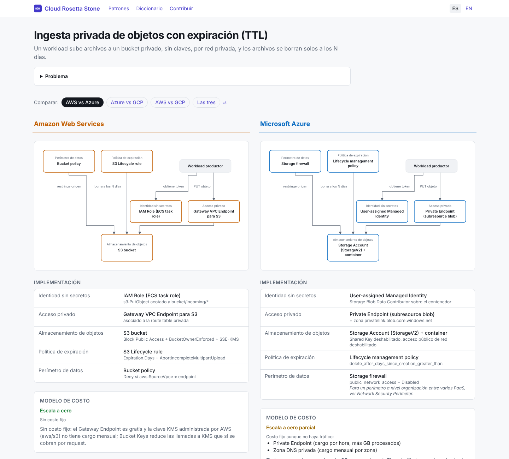

# Letra Chica

**La letra chica del multicloud: dónde se rompe la analogía entre Azure, AWS y GCP, con fuentes oficiales y Terraform verificado.**

_The fine print of multicloud — Spanish first, English included._

[](https://github.com/santiagodaros/Cloud-Rosetta-Stone/actions/workflows/ci.yml)
[](LICENSE)
[](LICENSE-CONTENT.md)

**Sitio:** https://santiagodaros.github.io/Cloud-Rosetta-Stone/ · **Datos abiertos:** [`/api/v1/patterns.json`](https://santiagodaros.github.io/Cloud-Rosetta-Stone/api/v1/patterns.json)

Las tablas de equivalencias dicen que S3 "es" Blob Storage. No te dicen que en Azure el prefijo de lifecycle
incluye el nombre del contenedor, que en GCP soft delete viene activo y te cobra 7 días extra por cada archivo
efímero, o que un `Deny` por `aws:SourceVpce` te deja afuera de tu propio bucket. Letra Chica compara
**patrones completos**, no servicios sueltos, y cada diferencia viene con su **fuente oficial y fecha de verificación**.



## Qué hay

- **Comparador lado a lado** (2 o 3 nubes) por patrón: diagrama con la misma topología, implementación por
  rol, modelo de costo, "letra chica" y Terraform.
- **Diagrama interactivo:** tocá un rol y ves qué lo implementa en cada nube y su letra chica; recorridos
  predefinidos (escritura, token, expiración…) y equivalentes parciales marcados con "≈".
- **Mi nube:** elegís la nube que ya conocés y cada rol te dice qué cambia ("Venís de Azure: …"), sin cuentas.
- **Gotchas verificables:** severidad, fuente oficial obligatoria, `verified_at` y examen de certificación
  donde suma (AZ-104, AZ-700, SAA-C03, ACE…).
- **Por examen:** cada certificación tiene su página con los gotchas que aplican y su estado (vigente, se
  retira, retirado → reemplazo), derivado de la fecha de retiro oficial.
- **Práctica:** modo a ciegas ("¿de qué nube es este gotcha?", con los nombres de producto tapados) y
  flashcards por examen con repetición espaciada (sin cuentas), más un gotcha del día.
- **Qué cambió:** cada gotcha nuevo, corregido o re-verificado, con diff y feed Atom.
- **Para el día a día:** cada gotcha y cada comparación se copian como Markdown (con fuente y atribución)
  para pegar en un PR o un ADR; "Reportar desactualizado" abre el issue ya completo.
- **Terraform que compila y es seguro:** cada módulo pasa `fmt`, `validate`, `terraform test` (sin
  credenciales), `tflint` y `checkov` en cada PR.
- **Diccionario** en tres partes: servicios (con huecos explícitos), **conceptos** (jerarquía, alcance de la
  red, zonas, identidad, tags: lo que más confunde al cambiar de nube) y **mapa de recursos Terraform**
  `azurerm_*` ↔ `aws_*` ↔ `google_*`, validado en CI contra el schema real de los providers.
- **Datos abiertos y para asistentes:** dataset JSON versionado (`/api/v1/`), `llms.txt` y un MCP server de
  solo lectura para que Claude o Copilot citen gotchas con su fuente. Ver [docs/DATASET.md](docs/DATASET.md).
- **Para compartir:** cada comparación tiene su imagen OG y cada gotcha un deep link.
- **Búsqueda** estática (Pagefind) en español e inglés.
- **Español primero**, inglés incluido. Sin cuentas, sin credenciales, sin trackers, $0.

## Estado

Fase 3 en curso: 5 patrones en las 3 nubes, 74 gotchas con fuente oficial, 28 capabilities, modo práctica y páginas por examen. Ver el
[plan](docs/PLAN.md) y el [análisis que lo originó](docs/ANALISIS-END-TO-END.md).

| Patrón | Azure | AWS | GCP |
|---|---|---|---|
| Ingesta privada de objetos con expiración (TTL) | Blob + lifecycle + Private Endpoint | S3 + lifecycle + Gateway Endpoint | GCS + lifecycle + PGA |
| Web API privada Zero Trust (PostgreSQL sin contraseñas) | ACA interno + PG Flexible (Entra) | ECS Fargate + ALB interno + RDS IAM | Cloud Run internal + Cloud SQL IAM |
| Worker asíncrono con escala a cero y dead-letter | ACA Jobs + Service Bus | Lambda + SQS | Cloud Run + Pub/Sub push |

## Desarrollo local

Requisitos: Node 22+, pnpm 10+. Terraform ≥ 1.7 solo si vas a tocar módulos.

```bash
pnpm install
pnpm dev          # http://localhost:4321
pnpm validate     # valida content/ (schema + referencias cruzadas)
pnpm test         # tests unitarios
pnpm build        # sitio estático en dist/ + índice de búsqueda
pnpm new:pattern mi-patron message-queue object-storage   # esqueleto de un patrón nuevo
```

Probar un módulo de Terraform sin credenciales:

```bash
cd content/patterns/object-storage-ttl/terraform/aws
terraform init -backend=false && terraform validate && terraform test
```

## Estructura

```
content/            ← el producto: patrones, capabilities, Terraform (PRs acá)
src/lib/schema.ts   ← schema del contenido (fuente de verdad)
src/lib/content.ts  ← carga + validación cruzada (la usan CI y el build)
src/lib/diagram.ts  ← layout ELK en build time → SVG
src/pages/          ← sitio Astro (es/en)
scripts/            ← validate, freshness report, matriz de Terraform para CI
docs/               ← plan, modelo de contenido, ADRs
docs/launch/        ← kit de lanzamiento (posts, Show HN, calendario)
```

## Contribuir

La contribución más valiosa no es un patrón nuevo: es **re-verificar un gotcha** y actualizar su
`verified_at`. Ver [CONTRIBUTING.md](CONTRIBUTING.md) y los issues
[`good first issue`](https://github.com/santiagodaros/Cloud-Rosetta-Stone/issues?q=is%3Aopen+label%3A%22good+first+issue%22).

## Licencia

Código y módulos de Terraform: [MIT](LICENSE). Contenido editorial y dataset: [CC BY-SA 4.0](LICENSE-CONTENT.md).
Proyecto independiente, sin afiliación con Microsoft, Amazon ni Google ([NOTICE](NOTICE.md)).
